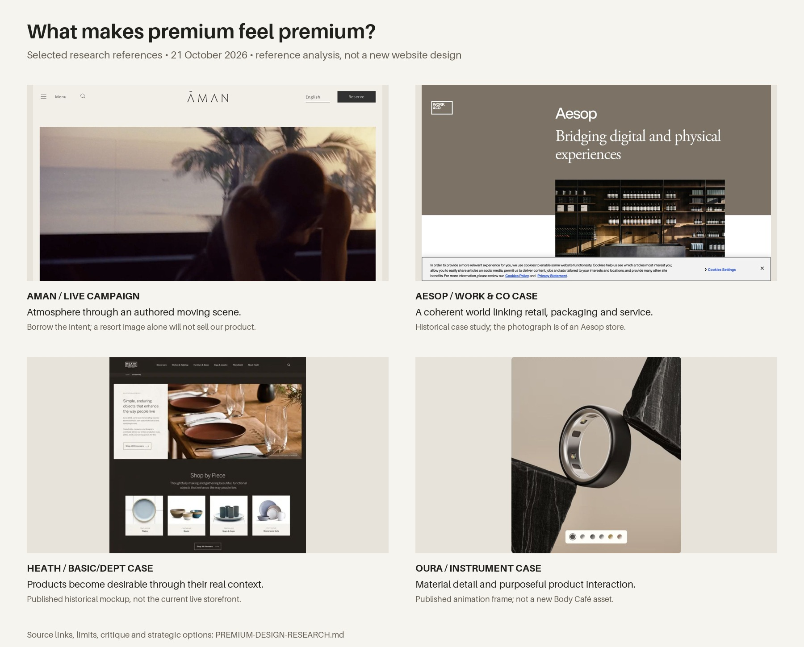

# Variant 5: premium design research

21 October 2026. Research and strategy only. No new website proposal is approved by this document.

## The decision we need to make

What should make Body Café Co. feel desirable before a visitor reads its product details?

The previous designs tried two surface treatments: dark bronze with architectural imagery, then warm paper with smaller typography. Both retained a familiar supplement-shop structure and familiar bottle imagery. The client's rejection is clear evidence that these treatments did not produce the intended feeling. It does not establish that all light or all dark designs fail.

**Working diagnosis:** we reduced visual noise without creating enough brand character, material richness or a compelling photographic world. That is an art-direction problem before it is a layout or animation problem. This is our interpretation of the feedback, not a proven consumer-study finding.

## Method and limitations

Reviewed eight primary brand pages and four original agency case studies, then added an Indian-market content check with Kama Ayurveda. Forest Essentials returned a 403 and was not reviewed. Used live browser inspection where accessible, published case-study images, the current Body Café build and the supplied brand guideline. Historical project images are identified separately from current live sites. No award-gallery ranking, fabricated user research or claim that a reference guarantees conversion.

Some live references were gated or incompletely rendered: The Row showed a shipping-country modal; Le Labo showed a location/cookie gate; Loro Piana navigation timed out; Seed's opening media did not fully appear in the browser capture. The Nue Co's media played but its screenshot was incomplete. Those captures are not used as finished visual proof. These sources still supplied readable public content/structure, with those limits.

## What the strongest sources actually teach

| Reference | Evidence | Useful principle for Body Café | Avoid copying |
|---|---|---|---|
| [Aesop / Work & Co](https://www.work.co/clients/aesop/) | Historical agency case: digital experience derived from packaging and store culture; coherent photography, writing and motion rules | Build one recognisable brand world from the real logo, packaging and customer questions | Copying its cream background and amber-bottle styling without its underlying identity |
| [Aman](https://www.aman.com/) | Live opening: sparse navigation, large atmospheric moving image, distinct wordmark and a quiet reserve action | A few authored scenes can establish an emotional setting | A hotel-style film that makes a supplement brand's product and purpose unclear |
| [Heath Ceramics / BASIC/DEPT](https://www.basicagency.com/case-studies/heath-ceramics-ecommerce-web-design) | Historical published project: contextual product photography and editorial material integrated into shopping | Let an object have a life and material context beyond a catalogue cutout | Inventing production craft, facilities or heritage Body Café has not documented |
| [Oura / Instrument](https://www.instrument.com/work/oura-smart-ring) | Published case: progressive information layers, lifestyle and CGI, purposeful micro-interactions | Product detail can be visually fascinating while deeper information remains accessible | Borrowing wearable UI, health metrics, or scientific proof the brand does not have |
| [Harrods / BASIC/DEPT](https://www.basicagency.com/case-studies/harrods-luxury-ecommerce-strategy) | Explicitly a **2018 conceptual vision**, not proof of today's Harrods site | Luxury can be expressed through curation, tactility and useful service | Decorative prestige, fake exclusivity or services that are not operational |
| [The Row](https://www.therow.com/) | Public site and partly visible live campaign behind a country gate; collection/archive/navigation hierarchy | Restraint needs strong image authorship and recognisable identity | Assuming a young supplement brand can depend on fashion-house recognition and unexplained imagery |
| [Loro Piana](https://us.loropiana.com/en/) | Public navigation includes material/collection stories and services; full visual review unavailable in this session | Material meaning and product context are useful research questions | Calling synthetic packaging heritage craft, or claiming a complete live visual audit |
| [Augustinus Bader](https://augustinusbader.com/) | Public site separates shop, science, journal and treatment/service content | Desire and detailed product explanation can coexist in the navigation | Importing its authority, endorsements, claims or scientific credibility |
| [Seed](https://seed.com/) | Current public shop/science/learn structure and ingredient/product detail pages | Clear information architecture can make a complex category easier to approach | Copying its scientific claims, subscription mechanics or outcome language |
| [The Nue Co](https://thenueco.com/) | Current homepage content connects a campaign to product discovery and editorial/audio material | A brand can own a cultural mood rather than showing only its packaging | Forcing a fragrance campaign or generic playlist into a supplement store |
| [Aesop brand philosophy](https://www.aesop.com/our-story.html) | Brand describes design and physical context as part of its work | Spatial coherence matters across touchpoints | Treating scenery as an interchangeable stock-image background |
| [Aesop category experience](https://www.aesop.com/skin-care.html) | Product discovery, explanatory content and assistance are presented together | Product discovery should feel considered and helpful | Copying another category's concerns or making unsupported personal recommendations |

Agency case studies describe their own work. Their reported outcomes do not prove causation and are not performance promises for Body Café.

## Why the current attempts feel ordinary: our critique

1. **The imagery could belong to many wellness brands.** A hand, glass, curtain and warm stone establish calm, but do not yet establish Body Café. A recognisable photographic idea needs repeated composition, lighting, props and human treatment.
2. **The product presentation loses its physical qualities.** Repeated front cutouts hide cap texture, print finish, curvature, scale and the experience of holding the object. Large renders alone do not solve this.
3. **The pages have too little contrast in emphasis.** A sequence of similarly quiet, similarly spaced sections is predictable. An intentional mix of close detail, human context, short text and focused shopping can create rhythm without clutter.
4. **The brand's strongest assets were underused.** The stacked black logo and seven cap colours already have character. Muting everything around them should make those assets feel intentional, not make the brand anonymous.
5. **“Premium” was left as an adjective.** We need agreed references and observable visual criteria. The next study must demonstrate them before implementation starts.
6. **Motion was added after the composition.** A moving crop of a still does not create the feeling of a filmed moment. Photography and movement need separate briefs.

## Brand fit: what we should retain

The supplied [logo guideline](../assets/brand/guidelines/Body%20Cafe%20Co%20logo%20guideline.pdf) calls for clear space, black/white logo treatments, Aileron as the primary brand typeface, and includes both product and product-plus-human photography. These are useful starting points for a distinctive system.

Keep the original logo geometry and seven cap colours. Test typography with real, long product names. Investigate Aileron's spacing, weight, size and editorial composition before introducing another font. Any contrasting typeface would need an explicit brand rationale and usable licence; a serif alone is not a luxury strategy.

## Three strategic territories to investigate

These are research hypotheses for one eventual Variant 5. They are not three new variants to build.

### 1. The design house — recommended starting point

**Feeling:** a contemporary house that treats everyday products as carefully designed objects.

**Reference combination:** Heath's contextual merchandising, Oura's material detail and The Row's editing. Principles only; no copied layouts.

**Creative ideas to test:**

- One composed still life of selected jars, with cap colours acting as precise accents. Camera height, shadows and negative space establish a recognisable photographic signature.
- A close observation of a hand opening or holding a pack. Show real scale, seams, grip and print quality without implying health outcomes.
- A paired editorial spread: a tactile human scene next to an exact product detail, visually related through light and framing.
- A focused “inside the object” study: outer pack, cap/closure, front label and confirmed ingredient identity. Only show assets that exist; no invented formula diagram.
- The seven products read as a family with carefully edited emphasis, rather than seven equal bottles dominating the first impression.

**Why it fits:** it works with the bold logo and coloured caps and can make the packaging feel more intentional without inventing heritage or a physical retreat.

**Main risk:** staged renders can look sterile or synthetic. The proof must show convincing materials, shadows and at least one human-context photograph.

### 2. The private retreat

**Feeling:** personal, unhurried and intimate, drawing on boutique hospitality.

**Reference combination:** Aman's atmosphere and Aesop's contextual coherence.

**Creative ideas to test:**

- An authored morning/evening scene, with a product naturally present at believable scale. The product has a reason to be there.
- A short film composed of real micro-actions: fabric movement, hand interaction, opening a pack. No slow pan over a static picture presented as live-action.
- Details of materials and light that recur across the entire campaign, instead of unrelated luxury props.
- A useful layer of product guidance and support that feels attentive. Only offer services the brand can actually provide.

**Why it could work:** it answers the desire for images and atmosphere beyond bottles.

**Main risk:** this is closest to the territory already rejected. Generic linen, water and stone will repeat that failure unless the imagery is much more specific and authored.

### 3. The precision studio

**Feeling:** exacting, intelligent and contemporary, with the confidence of a premium instrument.

**Reference combination:** Oura's layered explanation, Seed's information hierarchy and Aesop's packaging-led system.

**Creative ideas to test:**

- A strong product macro paired with a short piece of exact, useful information.
- A controlled transition between full object, cap detail and legible label information. The motion explains a relationship rather than decorating the page.
- A highly edited ingredient archive: names, forms and record access presented as a coherent editorial system.
- Human images that show ordinary use and scale, avoiding anonymous laboratory stock photography.

**Why it could work:** premium can come from precision and confidence rather than traditional luxury styling.

**Main risk:** unapproved label data limits what can be demonstrated. It must not imply research, manufacturing capability or clinical proof that is absent.

## The asset work the next visual study must prove

| Asset | Purpose | Acceptance test |
|---|---|---|
| Signature campaign composition | Establish the brand world | Recognisable as a coherent Body Café campaign; product and scene have a meaningful relationship |
| Human interaction photograph | Give scale, warmth and credibility | Natural anatomy/action, believable pack size, no stock-wellness gesture |
| Product family composition | Use the seven cap colours deliberately | Lighting, scale, perspective and label orientation agree across all jars |
| Material macro | Make the object feel physical | Crisp cap/print edges, convincing material response; no altered label content |
| Mobile composition | Prove the concept survives a phone | Subject and product remain meaningful at 390px, not an arbitrary centre crop |
| Motion sample | Test the intended feeling before building | A clear beginning/end or seamless loop, optional playback, no dependence on motion to understand content |

Reference photography and screenshots are for analysis, not website assets. We will not copy them into the storefront. Existing generated imagery can be reused only if it fits the selected concept; avoiding a new shoot is not a reason to weaken the direction.

## Interaction ideas worth keeping in the research

- A restrained change in light or crop can reveal material detail on hover; touch and keyboard users need an equivalent clear action.
- A product view should preserve position when moving from object to detail, so it feels like looking closer at the same object.
- Navigation, filters and bag should respond promptly and quietly. Their usability is part of the premium feeling.
- Use animation for focus or explanation. One carefully authored moving scene can be enough.
- Avoid scroll hijacking, forced loading sequences, excessive parallax, pointer gimmicks and repeated reveal animations on every paragraph.

No exact timing or easing system is selected yet. Those are design tests, not research conclusions.

## What happens before any more website work

1. Review the reference board and the three territories. Agree what “premium” should feel like for this brand.
2. Claude prepares one art-direction study: a signature composition, a material/detail treatment, a human image treatment and desktop/mobile opening compositions. This is a visual study, not a coded site.
3. Evaluate that study with the actual logo, existing packaging and real product names. Compare it directly with the rejected work.
4. Only after that direction is accepted, extend it to home, collection, product, bag and supporting pages. Codex then implements the selected system.

**Decision criteria:** distinct brand character; visible material quality; clean hierarchy; purposeful imagery; balanced page rhythm; mobile integrity; easy shopping; factual honesty. A light or dark palette is an outcome of the concept, not the concept itself.

## Research image provenance

- `aman.png`: live Aman opening captured in this session; campaign content may change.
- `aesop-case.png`: Work & Co's published case-study page, not a screenshot of today's Aesop homepage.
- `heath-published-mockup.png`: image published by BASIC/DEPT in its historical Heath case; includes mockup copy, not today's live site.
- `oura-case-frame.png`: a frame from an animated asset published by Instrument in its Oura case, not a complete live-site audit.
- `harrods-concept.png`: BASIC/DEPT's expressly conceptual Harrods design.
- The Row/Seed/Nue captures had rendering/gate limitations and are excluded from the selected visual board.

## Claude’s independent critique

Claude read eleven public sources as text and explicitly did not claim visual inspection. It supported the diagnosis that palette changes had replaced a point of view. It also stressed service and knowledge, the existing graphic brand assets, and the absence of comparable clinical/heritage proof.

Its proposed territories were The Counter (knowledge/service), Material Truth (specificity and physical detail) and Colour Editions (confident cap-colour art direction). It recommended Material Truth with a helpful service voice. Our recommendation above puts similar material care inside a broader design-house world, with human imagery: a macro-heavy solution alone would risk repeating the bottle-only problem the client has already identified. Neither recommendation is an approved direction.

### Indian-market check

[Kama Ayurveda](https://www.kamaayurveda.com/in) connects ingredient-named collections, rituals, gifting and Indian heritage in its public content. The useful question is how a premium story connects to familiar customer occasions and needs. Body Café should not borrow Ayurvedic heritage, traditional claims or gifting capabilities it has not established. This was a content review, not a completed visual/mobile audit. [Forest Essentials](https://www.forestessentialsindia.com/) was inaccessible (403); no visual conclusions were drawn from it.

### Selected reference board

The board shows captured source material and is not a proposed homepage or a pool of assets to reuse.
