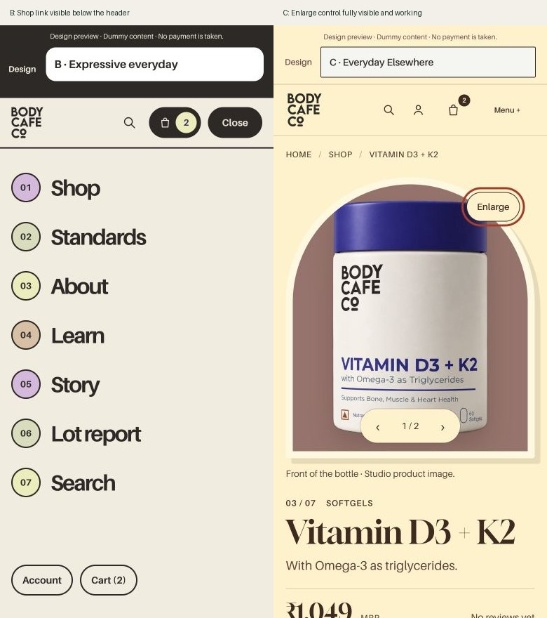

# Priority repairs — 26 October 2026

Completed the first two audit phases: usability repairs and shared-content consistency. The eight visual directions remain available.

## Changes

- A/C/D menus support both plain-text and icon/label buttons, restore their labels, and navigate without the null-element exception.
- B's mobile menu uses the measured header bottom rather than a fixed top padding, keeping Shop tappable at page top and after scrolling.
- Short-screen A/C/D menus scroll within the available height. Keyboard focus cycles through the open navigation; Escape closes it and returns focus. Resizing to desktop closes an unavailable mobile menu. Opening Search closes the navigation first.
- C keeps decorative arch clipping on the image track, leaving Enlarge and gallery controls accessible above it.
- H's bag count now uses white on near-black rather than pale gray on white.
- One demo pack helper supplies product facts, pack FAQs, shop cards and bag rows. Counts are explicitly labelled “Demo pack”; unknown products no longer inherit a generic 30-unit pack.
- Missing rear labels are directly identified as unavailable.
- Homepage design feedback uses illustrative headings and a “DESIGN EXAMPLE” stamp. Published reviews remain separate. E–H no longer claim there are no fictional examples anywhere on the site.
- Policy examples map to exact policy and section IDs. Delivery charges, delivery estimates, dispatch and failed delivery have distinct content. Unmapped pending sections retain their own information.
- Product and homepage delivery/return examples agree with policy summaries. Policy metadata is Preview 0.3, updated 26 October 2026.
- About points to the existing Contact details. Contact distinguishes working links from the local case preview rather than promising channel availability.

## Verification

- Existing Python suite: **74 tests passed**.
- New preview-content regression script passed: policy/section routing despite edited headings, retention of unrelated pending information, consistent delivery/return summaries, and pack status/quantity handling for all seven products.
- JavaScript syntax checks passed for changed scripts.
- Static preview rebuilt; hosted-preview API and publish-boundary checks passed. Nothing was published.
- Browser: 22 available mobile-menu journeys passed at 320, 390 and 768 px; A/D appropriately show desktop navigation at 768 px. Each route reached Shop, closed the menu and retained its design.
- Keyboard focus cycling, Escape and focus return passed in all eight variants at 390 px.
- B's Shop row hit-tested correctly both at page top and after scrolling. C's 320 × 568 menu was independently scrollable and stayed within the viewport.
- All seven C product Enlarge buttons opened the viewer at both 320 and 390 px: **14 successful zoom checks**.
- All seven products in all eight variants: **56 product-page checks** confirmed demo facts/FAQ agreement and the missing-label status.
- Shop, bag, About, five policies and homepage checked in all eight variants. No page-wide overflow appeared in those phone samples.
- H's final count colors were `rgb(255,255,255)` on `rgb(10,10,10)`.

Evidence: `menu-checks.json`, `focus-checks.json`, `zoom-checks.json`, `content-checks.json` and the after screenshots in this folder. `changes.diff` compares these repairs against the working files at the beginning of this phase, preserving earlier local edits.

## Remaining work

The broader audit still contains design refinements, mobile purchase hierarchy, complete approved product records, authentic business/evidence material, and performance/accessibility work. These repairs do not supply missing labels, clinical claims, live payments or genuine laboratory records.
